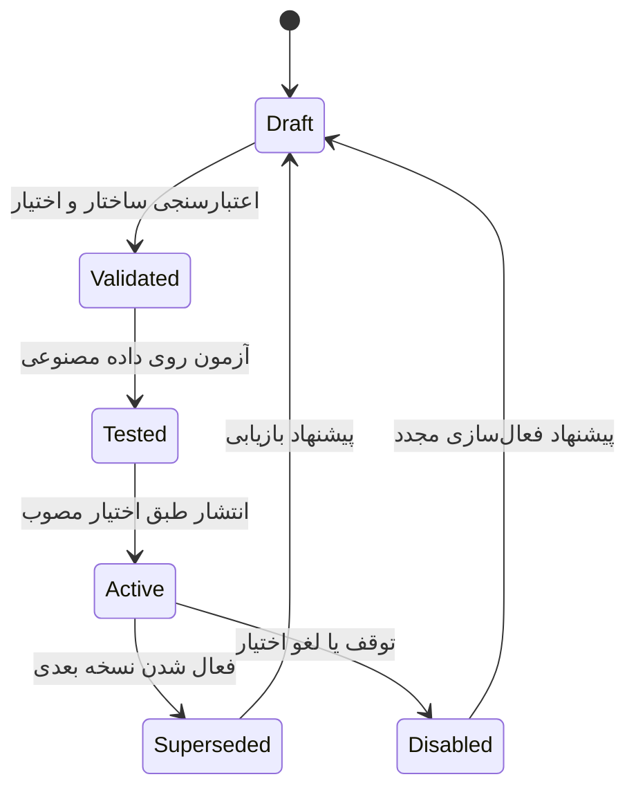

# مدیریت ایجنت‌ها توسط دستیار مرکزی

وضعیت: قرارداد پیشنهادی v0.1؛ طراحی، بدون endpoint یا اجرای عملیاتی.

## رفتار مورد انتظار

کاربر بتواند درخواست کند: «یک ایجنت تطبیق فیش بساز»، «دقت حسابدار را با این نمونه‌ها بهتر کن»، «دسترسی حسابدار به تغییر تعرفه را بردار» یا «به مدیر مالی اجازه ساخت پیش‌نویس تسویه بده». دستیار مرکزی وضعیت فعلی را می‌خواند، تغییر مشخص می‌سازد، آن را می‌سنجد و بر اساس اختیار مدیریتی موجود منتشر می‌کند یا برای تصمیم مسئول مجاز آماده نگه می‌دارد.

تغییر نام، هدف، دستور کار، مدل، ابزارهای درخواستی، حدود مصرف و ارتباط با ایجنت‌های دیگر در تعریف نسخه‌دار انجام می‌شود. تغییر مجوز واقعی از سرویس مستقل سیاست دسترسی عبور می‌کند. نوشتن نام یک ابزار در تعریف، آن ابزار را فعال نمی‌کند.

## سه لایه مستقل

| لایه | محتوا | مرجع تغییر |
|---|---|---|
| تعریف ایجنت | هدف، دستور کار، اتصال مدل، ابزارهای درخواستی و حدود پیشنهادی | دستیار مرکزی در محدوده اختیار مدیریت تعریف‌ها |
| مجوز اجرایی و اختیار واگذاری | ابزارهای مجاز، نوع عملیات، محدوده داده، اشخاص/نقش‌های هدف، انقضا و سقف‌ها | سرویس مجوز بر اساس سیاست مصوب کاربر یا مدیر مجاز |
| قواعد ثابت پلتفرم | جداسازی شرکت‌ها، حفاظت اسرار، کنترل ابزارها، ممیزی و سیاست انتشار کد مشترک | مسیر توسعه و انتشار پلتفرم |

دستیار مرکزی می‌تواند مجوزی را در محدوده اختیار واگذارشده ایجاد، محدود یا لغو کند. افزایش سقف همان اختیار، اعطای اختیار تازه به خودش یا تغییر قواعد ثابت با دستکاری prompt یا ساخت ایجنت واسط ممکن نباشد.

مدیر شرکت می‌تواند یک‌بار اختیار مشخصی بدهد؛ برای تغییرهای منطبق تأیید تکراری لازم نیست. نمونه: «برای ایجنت‌های مالی این شرکت، ابزارهای خواندن و ساخت پیش‌نویس را با سقف تعریف‌شده مدیریت کن». اجازه خواندن یک ابزار به‌تنهایی اجازه واگذاری آن ابزار را نمی‌دهد؛ مجوز استفاده و مجوز واگذاری دو فیلد مستقل‌اند.

## قواعد اجرایی اختیار واگذاری

۱. هویت و شرکت از نشست معتبر، Host و tenant-context سرور تعیین شوند. مدل و بدنه درخواست مجاز به انتخاب tenant یا credential نیستند. برای worker، context از تسک ثبت‌شده و هویت اجرایی معتبر بازسازی شود.

۲. اختیار مؤثر حاصل محدودترین اشتراکِ سیاست پلتفرم، پلن/ماژول فعال شرکت، مجوز درخواست‌کننده، مجوز ایجنت، سقف واگذاری، محدوده تسک و object-authz است. سطح شش انسانی، به‌تنهایی مجوز بی‌قیدِ ایجنت ایجاد نکند.

۳. سقف واگذاری، نقش‌های هدف مجاز، ابزارها و اعمال قابل واگذاری، محدوده داده، مدت اعتبار، هزینه و عمق واگذاری را صریح مشخص کند. wildcards در تعریف پیشنهادی پذیرفته نشوند؛ شناسه ابزار باید در رجیستری معتبر سرور وجود داشته باشد.

۴. واگذاری زنجیره‌ای فقط به شکل محدودتر از اختیار والد ممکن باشد. ایجنت جدید با نام، مدل یا prompt تازه نتواند محدودیت ایجنت قبلی را دور بزند. حق واگذاری دوباره پیش‌فرض خاموش باشد.

۵. تغییر مدل نیز با سیاست خروج داده شرکت سنجیده شود. مدل ارزان‌تر یا fallback، مجوز ارسال داده به ارائه‌دهنده تازه ایجاد نمی‌کند.

۶. هر تغییر شامل هویت درخواست‌کننده و اجراکننده، دلیل، نسخه قبلی، تفاوت، نتیجه آزمون، مجوز مبنا و زمان باشد. داده‌های حساس و کلیدها در log درج نشوند.

۷. لغو اختیار، اجرای بعدی ابزار را متوقف کند؛ در فعال‌سازی نسخه، زمان‌بندی، شروع worker و هر ابزار نوشتن دوباره بررسی شود. این کنترل باید در مرز اجرایی سرور باشد؛ اعتماد به متن prompt کافی نیست.

## چرخه نسخه ایجنت

هر ویرایش یک نسخه تغییرناپذیر می‌سازد. شکست آزمون نسخه جاری را تغییر نمی‌دهد. بازگشت به نسخه قبلی هم با مجوزهای امروز اعتبارسنجی می‌شود؛ بازیابی نسخه نباید مجوز لغوشده را برگرداند.

تسک در حال اجرا به نسخه تعریف و ابزارهایش متصل می‌ماند. تغییر prompt یا مدل، اجرای جاری را بی‌صدا جابه‌جا نمی‌کند؛ ولی لغو دسترسی فوراً در نخستین مرز ابزار بعدی اعمال می‌شود. شروع مجدد با نسخه تازه، اجرای جدید و قابل پیگیری است.

فعال‌سازی نسخه با کنترل هم‌زمانی و نسخه فعلی انجام شود. اگر کاربر یا کلاد هم‌زمان نسخه دیگری را فعال کرد، عملیات با تعارض نسخه متوقف شود و تفاوت جدید نشان داده شود. تصمیم تأییدشده به محتوای دقیق تغییر و نسخه سیاست متصل باشد، نه تنها شناسه ایجنت.

## ابزارهای مدیریتی پیشنهادی

این نام‌ها هنوز در رجیستری محصول وجود ندارند و اجرای آن‌ها در این بسته پیاده نشده است.

| ابزار | خروجی و اثر |
|---|---|
| `agents.list` | فهرست نقش‌ها، نسخه فعال و وضعیت در دامنه مجاز |
| `agents.get` | تعریف و مجوز مؤثر قابل نمایش؛ بدون اسرار اتصال مدل |
| `agents.draft` | ایجاد نسخه پیشنهادی برای نقش جدید یا موجود |
| `agents.validate` | بررسی ساختار، ابزارها، مدل، مجوز و بودجه؛ بدون اعطای دسترسی |
| `agents.evaluate` | اجرای نمونه‌های مصنوعی و مقایسه با نسخه فعال |
| `agents.preview-change` | تفاوت تعریف و مجوز، اثر بر تسک‌ها و زمان‌بندی‌ها |
| `agents.activate` | فعال‌کردن نسخه مشخص طبق سیاست و نسخه داده جاری |
| `agents.disable` | جلوگیری از شروع جدید و توقف ابزارهای آتی طبق سیاست |
| `agents.rollback-proposal` | ایجاد پیشنهاد بازیابی نسخه قبلی با مجوزهای امروز |
| `agents.grants.propose` | ساخت درخواست تغییر مجوز؛ فاقد اثر اجرایی |
| `agents.grants.apply` | اعمال تغییر فقط در سقف اختیار واگذاری معتبر |
| `agents.grants.revoke` | لغو مجوز در دامنه مدیریت؛ بدون حذف سوابق |

دستیار مرکزی تنها می‌تواند ابزارهای موجود را به نقش پیشنهاد دهد. ابزار اجرایی جدید، adapter جدید یا تغییر رفتار سرویس مالی باید در مسیر توسعه کد ساخته، آزموده و ثبت شود.

## قرارداد HTTP پیشنهادی

همه مسیرها زیر `/api` پروژه، احراز با کوکی HttpOnly و CSRF موجود، گارد feature/permission و object-authz دارند. نام دقیق مجوزها هنگام پیاده‌سازی در رجیستری واحد ثبت می‌شود. درخواست‌ها `tenantId` یا کلید API دریافت نمی‌کنند.

| مسیر پیشنهادی | عملیات |
|---|---|
| `GET /agents` | فهرست ایجنت‌های مجاز |
| `POST /agents` | ساخت تعریف پیش‌نویس طبق schema |
| `POST /agents/:id/versions` | نسخه جدید با `expectedRevision` |
| `POST /agents/:id/versions/:version/validate` | اعتبارسنجی و برآورد مجوز |
| `POST /agents/:id/versions/:version/evaluate` | تسک آزمون محدود روی داده مصنوعی |
| `POST /agents/:id/versions/:version/activate` | انتشار با نسخه سیاست، نسخه فعلی و مجوز معتبر |
| `POST /agents/:id/disable` | توقف تعریف |
| `POST /agents/:id/grant-changes` | پیشنهاد تغییر مجوز با اثر قابل مشاهده |
| `POST /agent-grant-changes/:id/apply` | اجرای پیشنهاد مشخص طبق اختیار مصوب |

نمونه envelope و statusها به‌عنوان پیشنهاد: `revision` عدد صعودی سروری؛ `status` یکی از draft/validated/tested/active/superseded/disabled؛ `decision` یکی از allowed/needs_approval/denied. خطاهای کاربر فارسی و کدهای ماشینی پایدار باشند. schema فقط ساختار درخواست تعریف را می‌سنجد؛ احراز، شناخت ابزار، حدود واگذاری و سیاست انتشار وظیفه سرویس است.

## مدل داده پیشنهادی

`AgentDefinition` هویت پایدار؛ `AgentVersion` تعریف تغییرناپذیر؛ `AgentGrant` اختیار اجرایی؛ `DelegationPolicy` سقف واگذاری؛ `AgentChangeProposal` پیش‌نمایش و نسخه داده؛ `AgentEvaluation` نتیجه آزمون؛ `AgentRun` و `AgentAction` وضعیت و اثر اجرا.

این‌ها نام‌های طراحی‌اند. در این بسته schema.prisma یا migration ایجاد نمی‌شود. داده‌های شرکت در دیتابیس همان شرکت بمانند. رجیستری ابزار و سیاست پلتفرم در کد و مسیر مدیریتی پلتفرم نگهداری شوند؛ tenant agent اجازه تعریف کد اجرایی در دیتابیس نداشته باشد.

## مثال‌های پذیرش

- ساخت ایجنت تطبیق دریافت با ابزارهای خواندن و پیش‌نویس در سقف مصوب، بدون سؤال دوباره انجام شود.
- درخواست افزودن `git.push` به حسابدار شرکت، با تغییر prompt یا ساخت نقش واسط مجوز نگیرَد؛ به مسیر توسعه پلتفرم ارجاع شود.
- درخواست لغو تغییر تعرفه از حسابدار، در دامنه اختیار مدیر مرکزی اعمال و در ابزار بعدی اجرا مؤثر شود.
- تغییر مدل به اتصال تأییدنشده یا درخواست ابزار ناشناخته رد شود.
- تغییر نام ایجنت، شناسه داده یا تعریف نسخه، امکان مشاهده شرکت دیگر را ایجاد نکند.
- دو درخواست فعال‌سازی هم‌زمان فقط با revision معتبر اعمال شوند؛ پاسخ تعارض به کاربر داده شود.
- نسخه جدیدی که آزمون را نمی‌گذراند، فعال نشود و نسخه قبلی ادامه دهد.
- rollback نسخه قدیمی، مجوز لغوشده یا سقف منقضی‌شده را زنده نکند.
- دستور داخل فیش، فرم یا پاسخ مدل دیگر اجازه تغییر تعریف یا مجوز ندهد؛ تنها درخواست معتبر و سیاست سرور چنین اثری داشته باشد.

## مرز پیاده‌سازی نخست

اول فهرست و پیش‌نویس نسخه‌دار به‌همراه اعتبارسنجی، نمایش تفاوت و ممیزی ساخته شود؛ سپس اجرای آزمون و فعال‌سازی؛ پس از آن مدیریت مجوز در سقف واگذاری. اتصال مالی و کدنویسی بر اساس ابزارهای آزموده‌شده به این هسته افزوده شوند. تا قبل از ساخت کنترل اجرایی مجوز، فیلدهای پیشنهادی schema برای دسترسی عملیاتی مصرف نشوند.
