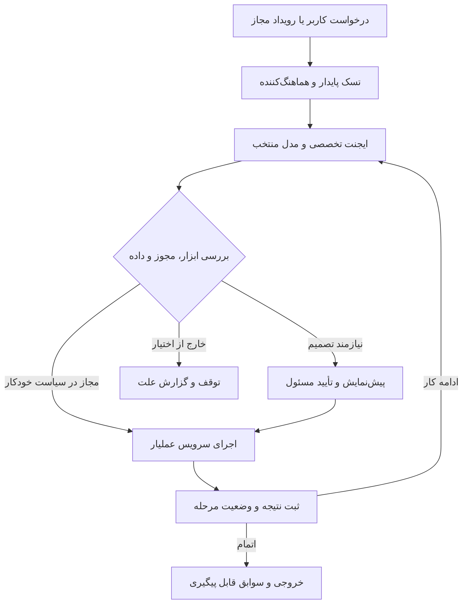

# طرح اجرایی دستیارهای عملیار

وضعیت: طرح اولیه معماری و برنامه توسعه از گفت‌وگوی قبلی. این نسخه برای سابقه تصمیم‌ها حفظ شده؛ قواعد مدیریت ایجنت در agent-management.md تکمیل شده‌اند. فایل‌های این بسته در شاخه طراحی ثبت می‌شوند و قابلیت عملیاتی فعال نمی‌کنند.

مبنای بررسی: مخزن `shabhossini-web/Amalyar`، شاخه `main`، کامیت `31d0ff494c1ec957b49b1b9c8564b0e6570fe253`، تاریخ ۲۰۲۶-۰۹-۱۲. بررسی ایستا و هدفمند بوده؛ اتصال واقعی مدل‌ها و استقرار آزموده نشده است.

هدف محصول: کاربر یک نتیجه را درخواست کند؛ عملیار داده مرتبط را پیدا کند، کار را به مراحل قابل اجرا تقسیم کند، از سرویس‌های معتبر خودش استفاده کند و نتیجه و تغییرات را قابل پیگیری تحویل دهد. قواعد مالی و دسترسی همچنان در سرور اجرا می‌شوند.

## ۱. وضعیت موجود و فاصله تا اجرای ایجنتی

| بخش | شواهد موجود | توسعه لازم |
|---|---|---|
| اتصال AI | `AiService` از رابط سازگار با `chat/completions` استفاده می‌کند. تنظیمات مرکزی و اختصاصی شرکت، مدل گفتگو و مدل‌های کاربردهای دیگر وجود دارد. | تعریف قابلیت هر اتصال، انتخاب مدل بر اساس وظیفه و قرارداد استاندارد درخواست ابزار |
| تنظیم ارائه‌دهنده | نام‌های `avalai`، `gapgpt` و `custom` در مدل تنظیمات مرکزی پیش‌تنظیم رابط هستند؛ اجرای فعلی بر پایه `baseUrl` است. | چند اتصال قابل انتخاب برای نقش‌ها؛ آزمون واقعی پشتیبانی ابزار و خروجی ساخت‌یافته برای هر اتصال |
| دستیار مدیریت | تولید پاسخ و جستجوی محدود بیمار، بیمارستان و کالا وجود دارد. | اجرای ابزارهای عملیاتی و مدیریت کار چندمرحله‌ای |
| فرم‌ساز | تعریف فرم، افزودن و ویرایش فیلد، ترتیب، اعتبارسنجی و قالب‌های حوزه‌ای وجود دارد. | تولید پیش‌نویس فرم توسط AI، نسخه‌بندی، پیش‌نمایش تغییر، انتشار و بازیابی نسخه |
| گردش‌کار | جریان‌های مشخص پذیرش، فرم و پیگیری وجود دارد. | موتور عمومی رویداد، شرط، اقدام، انتظار و نسخه اجرای گردش‌کار |
| امور مالی | صورتحساب، پرداخت، هزینه، سهم و دفتر شرکا در کد وجود دارد. | ابزارهای مجاز ایجنت، پیشنهاد تغییر و اجرای قابل تکرار بدون ثبت مضاعف |
| کارهای پس‌زمینه | workerهای تخصصی در پروژه وجود دارند. | صف پایدار اجرای ایجنت با توقف، ادامه، بودجه و ثبت مرحله |
| مجوزها | ماتریس feature/permission و بررسی‌های سرویس موجود است؛ مسیرهای AI ترکیبی از سطح و بررسی مجوز دارند. | کنترل یکپارچه هویت و مجوز هر ابزار در زمان اجرای واقعی |

وجود مدل‌های صوت، تصویر و گفتگو در تنظیمات، به معنی فعال بودن یا آزموده‌شدن همه قابلیت‌های ارائه‌دهنده نیست. کد فعلی برای هر درخواست تنظیم مؤثر شرکت یا تنظیم مرکزی را انتخاب می‌کند؛ مسیریابی چند ایجنت به چند ارائه‌دهنده باید اضافه شود.

## ۲. نقش‌ها و دامنه اختیار

| نقش | مسئولیت | ابزارهای پیشنهادی | محدوده |
|---|---|---|---|
| هماهنگ‌کننده | فهم درخواست، انتخاب متخصص و جمع‌کردن نتیجه | ساخت تسک، مشاهده وضعیت، واگذاری محدود | فاقد مجوز مستقل برای دور زدن ابزارهای تخصصی |
| حسابدار | تطبیق دریافت‌ها، ساخت پیش‌نویس فاکتور، ثبت هزینه مجاز و شناسایی مغایرت | دریافت‌های مراجعه، محاسبه فاکتور، پیشنهاد ثبت یا اصلاح، مشاهده مصرف | داده مالی شرکت و اطلاعات ضروری همان مراجعه |
| مدیر مالی | تحلیل مانده‌ها، جریان دریافت و پرداخت و پیشنهاد تسویه یا تغییر تعریف مالی | گزارش تجمیعی، بررسی قرارداد و تعریف، پیش‌نمایش اثر تغییر | دامنه مالی شرکت؛ تصویب AI جای مجوز انسانی را نمی‌گیرد |
| فرم‌ساز و گردش‌کار | ساخت و مرتب‌کردن فرم و تعریف مراحل کاری | خواندن تعاریف، تولید schema، اعتبارسنجی، پیش‌نمایش، انتشار نسخه مجاز | تنظیمات همان شرکت |
| توسعه‌دهنده پلتفرم | بررسی خطا، اصلاح کد، آزمون، commit و push شاخه کاری و ساخت PR | خواندن مخزن، محیط اجرای موقت، تست و Git | سطح پلتفرم و مخزن مجاز؛ مستقل از دسترسی حسابدار شرکت |

این نقش‌ها می‌توانند از یک هسته اجرایی و حتی یک مدل استفاده کنند. تفاوت اصلی در دستور کار، ابزارها، مجوزها و معیار موفقیت است. برای هر تسک فقط نقش‌های لازم فراخوانی می‌شوند.

ایجنت مالی می‌تواند نقص نرم‌افزار را همراه یک نمونه بدون اطلاعات بیمار به ایجنت توسعه ارجاع دهد. ایجنت توسعه تنها در صورت وجود مجوز مستقل توسعه برای آن درخواست وارد اجرا می‌شود. دسترسی مدیر یک شرکت به حساب‌های خودش، مجوز تغییر کد مشترک تمام شرکت‌ها ایجاد نمی‌کند.

## ۳. معماری اجرا

مدل نام ابزار و آرگومان ساخت‌یافته پیشنهاد می‌کند؛ برنامه ابزار را اعتبارسنجی و اجرا می‌کند و نتیجه را به مدل برمی‌گرداند. این تفکیک، مبنای جریان رسمی [Function calling](https://developers.openai.com/api/docs/guides/function-calling) است. انتخاب این معماری به معنی تعهد به یک ارائه‌دهنده یا چارچوب خاص نیست.

ابزارهای نوشتن باید سرویس‌های دامنه موجود را فراخوانی کنند. خواندن و نوشتن مستقیم SQL و اجرای کد دلخواه برای ایجنت‌های شرکت ارائه نمی‌شود. اگر سرویس داخلی تنها به گارد کنترلر تکیه دارد، قبل از اتصال ایجنت باید همان کنترل در مرز اجرایی ابزار یا سرویس نیز اعمال شود.

پوشه‌های پیشنهادی توسعه، هنوز ایجاد نشده‌اند:

- `server/src/agents/`: تسک، نقش‌ها، کنترل مجوز، رجیستری ابزار و رخدادهای اجرا.
- `server/src/ai/providers/`: تطبیق اتصال‌ها و قابلیت‌های مدل.
- `server/src/workflows/`: تعریف نسخه گردش‌کار و اجرای پایدار آن.
- `src/app/AgentWorkspace.jsx`: مرکز فرمان، تسک‌ها، خروجی‌ها و موارد نیازمند تصمیم.
- محیط worker مستقل برای توسعه کد، با credential محدود Git و بدون اتصال به دیتابیس عملیاتی شرکت‌ها.

## ۴. سیاست دسترسی و خودکارسازی

اختیار مؤثر هر اجرا از اشتراک این موارد به دست می‌آید: مجوز کاربر یا هویت اجرایی زمان‌بندی‌شده، سیاست شرکت، مجوز نقش ایجنت، محدوده همان تسک، و دسترسی به شیء موردنظر. `tenantId` از نشست معتبر یا هویت اجرایی ثبت‌شده تعیین می‌شود؛ خروجی مدل اجازه انتخاب شرکت دیگری را ندارد.

ایجنت نباید با ساخت کاربر سطح شش، bypass موجود ادمین را به دست بیاورد. خاموش‌کردن یک ماژول یا لغو مجوز باید اجراهای در صف و ادامه تسک‌ها را هم در نخستین اقدام بعدی متوقف کند.

| دسته عملیات | سیاست اولیه پیشنهادی |
|---|---|
| جستجو، گزارش و محاسبه | خودکار در دامنه مجاز |
| ساخت پیش‌نویس فاکتور، فرم و گردش‌کار | خودکار با اعتبارسنجی و ثبت منشأ |
| صدور فاکتور روتین | قابل خودکارسازی با مجوز دائمی صریح، قالب و روش قیمت‌گذاری مشخص، داده کامل و نبود مغایرت |
| تغییر تعرفه، حساب دریافت، سند نهایی یا موجودی | پیش‌نمایش تغییر و تأیید مسئول مجاز در سیاست اولیه |
| پرداخت واقعی پول | تنها با اتصال اجرایی لازم و سیاست مجاز مربوط به پرداخت؛ پیش‌فرض نیازمند تأیید نهایی |
| اصلاح کد، commit و push شاخه اختصاصی | قابل اجرا پس از تعریف مجوز توسعه و دامنه مخزن |
| merge به main، migration و استقرار | تابع سیاست انتشار پلتفرم و نتیجه گیت‌های مربوط |

کاربر یک‌بار می‌تواند قاعده‌ای مانند «فاکتورهای گلوبال کامل و بدون مغایرت این شرکت را بر مبنای دریافت تأییدشده صادر کن» تعریف کند. برای هر اجرای منطبق، دوباره تأیید گرفته نمی‌شود. تغییر دامنه، مبلغ، هدف یا داده‌های مؤثر باید دوباره با همان سیاست سنجیده شود.

تأیید روی پیش‌نمایش مشخص، شناسه اقلام، نسخه داده و محتوای تغییر ثبت می‌شود. اگر داده بعد از پیش‌نمایش تغییر کند، نتیجه باید دوباره محاسبه و مطابق سیاست بازبینی شود. ایجنت اجازه تغییر سیاست اختیار خودش را ندارد.

## ۵. نخستین جریان عملی: فاکتور نورومانیتورینگ

درخواست نمونه: «برای مراجعات پرداخت‌شده این بازه فاکتور آماده کن و مغایرت‌ها را جدا نشان بده.»

۱. تنها مراجعات شرکت و بازه مجاز خوانده شود.

۲. دریافت ثبت‌شده و تأییدشده، ارتباط فیش با مراجعه و سابقه صدور بررسی شود؛ وجود تصویر فیش به‌تنهایی معادل تأیید دریافت نیست.

۳. ساعت عمل، خدمات واقعی، کد و سال تعرفه، ضرایب مربوط و گزارش مصرف کارشناس دریافت شود. داده ناقص با حدس تکمیل نشود.

۴. محاسبه از سرویس مالی انجام شود. در گلوبال، مبلغ تعیین‌شده و در سناریوی توافق‌شده مبلغ دریافتی X مبناست؛ ریز تعرفه حفظ می‌شود. در روش جمع اقلام، حاصل واقعی اقلام مبناست و اختلاف با دریافت به‌عنوان مانده یا اضافه‌پرداخت نمایش داده می‌شود.

۵. نمایش قلم، اثر مالی و اثر انبار مستقل بمانند. فاکتور به مصرف ثبت‌شده کارشناس ارجاع دهد؛ همان مصرف دوباره از انبار کسر نشود.

۶. پیش‌نویس قابل مشاهده ساخته شود. صدور با سیاست همان شرکت انجام شود و نسخه ثابت شماره‌دار، منشأ محاسبه و ارتباط پرداخت‌ها نگهداری شود.

۷. خروجی شامل تعداد آماده، تعداد صادرشده، مجموع مبلغ و فهرست استثناها با لینک به مراجعه باشد. تا زمانی که داده کافی نیست، تسک به وضعیت «نیازمند تکمیل اطلاعات» برود.

برای ایمپلنت، همین جریان از اقلام و قیمت‌های شرکت استفاده می‌کند. ابزار رسیدن جمع اقلام به مبلغ هدف باید در سرویس مالی پیاده شود و فقط قیمت یا تخفیف اقلام مجاز را تغییر دهد؛ مقدار و هویت مصرف واقعی حفظ شود. پیشنهاد یا تصمیم مدل مستقیماً فرمول مالی را عوض نمی‌کند.

## ۶. حسابدار و مدیر مالی

کارهای مناسب: گزارش مطالبات، تطبیق دریافتی و صورتحساب، تشخیص ثبت تکراری، آماده‌کردن هزینه و تسویه، بررسی اقلام مصرف‌شده فاقد ردیف فاکتور و توضیح منشأ اعداد.

محاسبه مبلغ، گرد کردن، مانده، سهم‌ها و کنترل‌های مالی در توابع قطعی سرور انجام می‌شود. واحد پول پروژه تومان است. مدل برای استخراج، توضیح و پیشنهاد استفاده می‌شود؛ مبلغ معتبر از نتیجه سرویس می‌آید.

در مدل‌های بررسی‌شده، دفتر شرکا و خدمات مالی عملیاتی دیده شد. برای ادعای «حسابداری کامل»، دامنه دفتر کل، کدینگ حساب‌ها، اسناد دوبل، تراز بدهکار و بستانکار و بستن دوره باید جدا بررسی و در صورت نبود تکمیل شود. افزودن ایجنت به‌خودی‌خود این زیرساخت حسابداری را ایجاد نمی‌کند.

## ۷. فرم‌ساز و گردش‌کار

درخواست نمونه: «برای عمل‌های نورو فرم مصرف الکترود بساز؛ نوع از کالاهای مجاز شرکت انتخاب شود و تعداد مصرف‌شده برای هر بیمار ثبت شود.»

ایجنت تعاریف فعلی و کلیدهای رزروشده را می‌خواند، یک schema پیشنهادی می‌سازد، پیش‌نمایش و اعتبارسنجی تولید می‌کند و اتصال فیلدها به خدمات دامنه را مشخص می‌کند. عملیات مؤثر بر انبار و مالی باید ابزار اجرایی معتبر داشته باشد؛ صرف ساخت فیلد «تعداد مصرف» ثبت انبار ایجاد نمی‌کند.

گردش‌کار از بلوک‌های رویداد، شرط، اقدام، انتظار، تصمیم و پایان تشکیل شود. نسخه منتشرشده هر گردش‌کار ثابت باشد و هر اجرا به همان نسخه متصل بماند. نسخه جدید، اجراهای در حال انجام و پاسخ‌های قدیمی فرم را بی‌صدا تغییر ندهد. شناسه پایدار فیلدها، ارجاع داده و برنامه مهاجرت در تغییرات ناسازگار لازم است.

اولین بلوک‌ها: تکمیل گزارش کارشناس، بررسی داده لازم، آماده‌کردن فاکتور، ارجاع مغایرت و ثبت نتیجه. اعمال کد دلخواه JavaScript، SQL یا shell به‌عنوان شرط فرم در دسترس ایجنت شرکت قرار نگیرد.

تغییر فرم و گردش‌کار تا جایی که بلوک موجود پاسخ می‌دهد در تنظیمات همان شرکت انجام می‌شود. نیاز به رفتار نرم‌افزاری تازه به ایجنت توسعه پلتفرم ارجاع می‌شود.

## ۸. اجرای تغییر کد و Git

ایجنت توسعه یک شرح مسئله و نمونه مصنوعی می‌گیرد؛ در checkout یا worktree موقت شاخه می‌سازد، اصلاح می‌کند، آزمون‌های مرتبط را اجرا می‌کند، commit می‌زند، به شاخه مجاز push می‌کند و PR همراه توضیح اثر و نتیجه آزمون ارائه می‌دهد.

دسترسی نوشتن Git باید مستقل و محدود به مخزن و شاخه‌های تعریف‌شده باشد. کلیدهای مدل، دیتابیس، پیامک و داده بیمار در مخزن، log اجرای کد یا متن PR قرار نگیرند. محیط توسعه agent به دیتابیس production متصل نشود؛ fixture و داده مصنوعی برای بازتولید استفاده شود.

تغییر عمومی عملیار می‌تواند بر همه شرکت‌ها اثر بگذارد؛ بنابراین کنترل انتشار در سطح پلتفرم است. آزمون و PR قابل خودکارسازی‌اند؛ merge و استقرار نیز فقط مطابق مجوز و گیت انتشار تعریف‌شده اجرا می‌شوند. این سند به معنی صدور مجوز push یا deploy در این گفت‌وگو نیست.

## ۹. پایداری اجرا و ارتباط چند مدل

- هر تسک شناسه، شرکت، درخواست‌کننده، نسخه نقش، سیاست اختیار، بودجه، موعد و وضعیت داشته باشد.
- وضعیت‌ها حداقل شامل queued، running، waiting_input، waiting_approval، succeeded، failed و cancelled باشند. مرحله‌های تکمیل‌شده پس از قطع ارتباط از ابتدا اجرا نشوند.
- برای تغییر مالی و انبار، کلید یکتای عملیات در دیتابیس و داخل همان تراکنش اثر تجاری ثبت شود. تحویل دوباره پیام صف یا timeout نباید سند یا مصرف دیگری ایجاد کند.
- worker از lease، heartbeat، شمارش تلاش و retry محدود استفاده کند. در خطای مبهم ابتدا نتیجه قبلی بررسی شود؛ تلاش مجدد کورکورانه مناسب عملیات مالی نیست.
- رویداد بعد از ثبت قطعی دامنه منتشر شود؛ الگوی outbox می‌تواند فاصله بین commit و تحویل رویداد را پوشش دهد.
- توقف تسک، کارهای آتی را متوقف می‌کند. اثر مالی ثبت‌شده با اقدام جبرانی معتبر اصلاح می‌شود؛ وعده rollback همگانی داده نشود.
- نام ابزار، آرگومان‌های پالایش‌شده، نتیجه، زمان، actor، شناسه تسک و منشأ داده ثبت شود. نمایش اقدام و نتیجه برای ممیزی کافی است؛ ثبت استدلال خصوصی مدل هدف نیست.
- سقف تعداد مرحله، زمان، توکن و هزینه برای شرکت و تسک وجود داشته باشد. واگذاری بین ایجنت‌ها نیز عمق و تعداد محدود داشته باشد.
- مسیریابی مدل بر مبنای قابلیت و آزمون فارسی، ابزار و استخراج انجام شود. در fallback همان سیاست داده و ارائه‌دهنده مجاز حفظ شود؛ تغییر مدل مجوز جدید ایجاد نمی‌کند.
- انتخاب نام مدل و ارائه‌دهنده نهایی پس از آزمون روی اتصال‌های واقعاً فعال انجام شود. در این سند هزینه یا برتری قطعی مدلی ادعا نمی‌شود.

## ۱۰. جداسازی شرکت‌ها و داده ورودی

دیتابیس مستقل هر شرکت مطابق تصمیم پروژه حفظ شود. حافظه تسک، نمونه‌های اصلاح‌شده، جستجو، فایل‌ها، cache و سوابق اجرا نیز در همان مرز شرکت باشند. مرکز پلتفرم می‌تواند تنظیم مدل و سهمیه را نگه دارد؛ محتوای مالی و پزشکی شرکت‌ها در حافظه مشترک ایجنت‌ها قرار نگیرد.

متن فرم بیمار، فایل پیوست، پاسخ مدل دیگر و نتیجه جستجو داده ورودی هستند. دستور موجود در آن‌ها نباید مجوز فراخوانی ابزار یا تغییر سیاست ایجاد کند. اعتبارسنجی schema، محدودکردن داده ارسالی و کنترل اجرای ابزار مکمل هم‌اند؛ هیچ‌کدام به‌تنهایی تضمین مصونیت نیستند. این طراحی با اصول محدودسازی داده ساخت‌یافته و ورودی نامطمئن در [راهنمای رسمی ساخت ایجنت](https://developers.openai.com/api/docs/guides/agent-builder-safety) همسو است.

مجوزها هنگام اجرای هر ابزار دوباره سنجیده شوند. زمان‌بندی‌ها هویت اجرایی مشخص و قابل لغو داشته باشند؛ ادامه کار یک کاربر غیرفعال از طریق تسک قدیمی مجاز نباشد.

## ۱۱. تجربه کاربری

مرکز فرمان یک ورودی متنی یا صوتی، انتخاب محدوده شرکت و نوع کار، فهرست تسک‌ها و وضعیت اجرا داشته باشد. هر تسک نشان دهد چه چیزی بررسی شده، چه چیزی تغییر کرده، چه داده‌ای کم است و نتیجه کجاست.

مدیر برای هر نقش حوزه داده، ابزارهای مجاز، مدل، بودجه و سطح خودکارسازی را تعریف کند. درخواست تصمیم باید شامل تغییر مشخص و اثر آن باشد؛ فهرست طولانی تأیید برای تک‌تک خواندن‌ها لازم نیست. تنظیمات فنی مدل در صفحه مدیریت باقی بماند و کاربر روزمره با نتیجه و کار تجاری روبه‌رو شود.

## ۱۲. ترتیب توسعه و معیار پذیرش

| مرحله | خروجی قابل تحویل | شرط عبور |
|---|---|---|
| ۱. هسته اجرا | تسک پایدار، رجیستری ابزار، هویت محدود و گزارش رویداد | رد دسترسی بین دو شرکت و دو کاربر؛ توقف پس از لغو مجوز |
| ۲. حسابدار عملیاتی | تطبیق پرداخت، مصرف و پیش‌نویس فاکتور نورو | برابری محاسبه با سرویس موجود؛ عدم ثبت مضاعف در retry؛ گزارش داده ناقص |
| ۳. اجرای خودکار محدود | صدور روتین بر مبنای سیاست منتشرشده | کنترل snapshot و نسخه داده؛ استثناها خارج از مسیر خودکار |
| ۴. فرم و گردش‌کار | ساخت schema، پیش‌نمایش، انتشار و اجرای نسخه‌دار | حفظ پاسخ‌های قدیمی، کنترل کلید رزروشده و جلوگیری از اجرای دوباره رویداد |
| ۵. مدیر مالی و ایمپلنت | گزارش مالی مستند و رسیدن اقلام به مبلغ هدف | منشأ همه اعداد روشن؛ حفظ مصرف واقعی؛ کنترل قواعد قیمت‌گذاری |
| ۶. توسعه‌دهنده | محیط مستقل، اصلاح و آزمون و PR | داده مصنوعی، مجوز محدود مخزن، جلوگیری از تغییر خارج از دامنه و کنترل انتشار |

آزمون‌های مشخص لازم: درخواست شناسه متعلق به شرکت دیگر، تغییر مبلغ بعد از تأیید، مصرف قبلی کارشناس و ورود همان قلم به فاکتور، timeout پس از commit، دو worker روی یک مراجعه، تعرفه ناقص، دستور مخرب داخل پیوست، قطع ارائه‌دهنده، تغییر نسخه فرم و محدودیت شاخه Git.

پیشنهاد نخستین برش توسعه: «پرداخت تأییدشده + گزارش مصرف کارشناس → پیش‌نویس فاکتور نورو + فهرست مغایرت‌ها». این برش یک نتیجه قابل سنجش دارد و پیش‌نیازهای مالی بحث قبلی را نیز روشن می‌کند. زمان‌بندی عددی پس از شکستن همین برش به تغییرات و آزمون‌های واقعی تعیین شود.

## منابع بررسی کد

- [سرویس AI](https://github.com/shabhossini-web/Amalyar/blob/31d0ff494c1ec957b49b1b9c8564b0e6570fe253/server/src/ai/ai.service.ts)
- [کنترلر AI](https://github.com/shabhossini-web/Amalyar/blob/31d0ff494c1ec957b49b1b9c8564b0e6570fe253/server/src/ai/ai.controller.ts)
- [تنظیمات AI](https://github.com/shabhossini-web/Amalyar/blob/31d0ff494c1ec957b49b1b9c8564b0e6570fe253/server/src/config/settings.service.ts)
- [مدل‌های مرکزی](https://github.com/shabhossini-web/Amalyar/blob/31d0ff494c1ec957b49b1b9c8564b0e6570fe253/server/prisma/control/schema.prisma)
- [مدل‌های شرکت](https://github.com/shabhossini-web/Amalyar/blob/31d0ff494c1ec957b49b1b9c8564b0e6570fe253/server/prisma/schema.prisma)
- [فرم‌ساز](https://github.com/shabhossini-web/Amalyar/blob/31d0ff494c1ec957b49b1b9c8564b0e6570fe253/server/src/patients/forms.service.ts)
- [ثبت مجوزها](https://github.com/shabhossini-web/Amalyar/blob/31d0ff494c1ec957b49b1b9c8564b0e6570fe253/server/src/auth/access-registry.ts)
- [کنترل دسترسی](https://github.com/shabhossini-web/Amalyar/blob/31d0ff494c1ec957b49b1b9c8564b0e6570fe253/server/src/auth/access-check.ts)
- [دفتر و هزینه‌ها](https://github.com/shabhossini-web/Amalyar/blob/31d0ff494c1ec957b49b1b9c8564b0e6570fe253/server/src/patients/ledger.service.ts)
- [گردش‌های فعلی محصول](https://github.com/shabhossini-web/Amalyar/blob/31d0ff494c1ec957b49b1b9c8564b0e6570fe253/docs/PROFILE_WORKFLOWS_2026-09-09.md)

این منابع وضعیت همان نسخه کد را نشان می‌دهند. وجود فایل تست یا مستند قبلی به معنی اجرای آن آزمون در این بررسی نیست.
